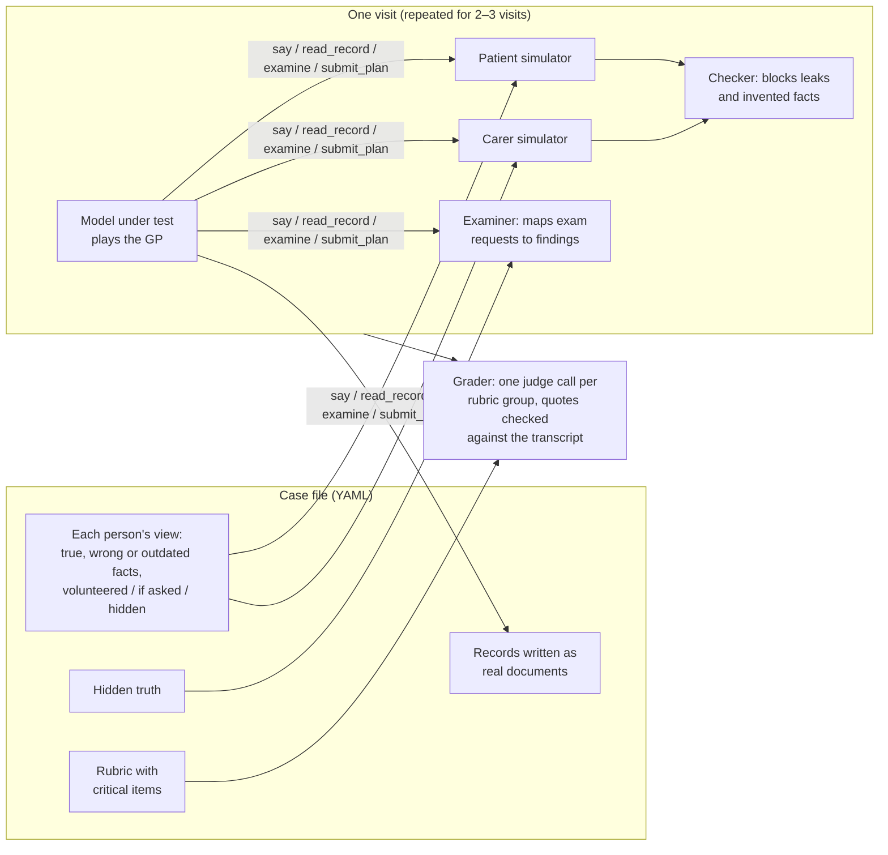

# clinical-env

**A multi-agent simulator and grading harness that tests whether frontier AI models can manage
a frail older adult across several home and clinic visits, when the patient, a carer and the
records disagree.**

Built by a doctor working with AI coding agents, in about a week, to answer one question before
building a company on it: *do frontier models fail at this?*

**Answer: no.** OpenAI's flagship (gpt-6-astra, high effort) met every critical item in
**39 of 39** runs across 10 case variants, each under a rule committed to Git before the runs.
What it misses is consultation craft and local practice detail. An 8-line generic prompt fixed
most of those, and real UK documents fixed the rest. Repeating one case 10 times showed its
hardest critical decision varying between runs (missed in 1 to 2 of 10), which 3 runs hide. The full write-up is in [docs/findings.md](docs/findings.md).

## The cases

Every case is **fictional but clinically grounded**. A practising clinician wrote them from real
clinical experience, then anonymised and fictionalised them: no real names, dates, places or
patient details, and a check in the validator that refuses absolute dates. Some are adapted from
open-licence published case reports (CC BY / CC0, credited in [ATTRIBUTION.md](ATTRIBUTION.md)).

- **Published:** 12 dev cases (UK and US) with their records, hidden truths and rubrics, so
  anyone can rerun the harness.
- **Withheld:** a second, private set of memory-clinic cases used as a **held-out test set**.
  They stay unpublished so future models cannot be tuned against them. The task, grader and
  every result are published ([docs/findings.md](docs/findings.md), item 6).

## How it works



- **The model under test only ever has tools.** It can `say` to the patient or carer,
  `read_record`, `examine` and `submit_plan`. It never sees the hidden truth, the rubric or
  what other people know.
- **People have secrets.** Each fact a patient or carer holds has an accuracy (true, wrong or
  outdated) and a disclosure rule: volunteered, said if asked, or hidden until a specific
  condition is met ("asked about his own health, or who could step in if he were away"). A
  cheap checker model reads every simulated reply and regenerates it if it leaks a hidden fact
  or invents one.
- **Records are real documents.** Discharge summaries, GP records, pharmacy histories and
  ambulance reports are rendered from templates with fact slots, so a wrong or outdated fact
  can sit in a record and contradict what a person says.
- **Multi-visit.** Each visit is a fresh model context that carries only its own earlier plans
  and record entries. Patients and carers remember what was said to them. Tests ordered at one
  visit come back by the next.
- **Grading resists judge mistakes.** One judge call per rubric group per visit. The code then
  checks what judges get wrong most: every quote is matched against the transcript, `requires`
  conditions ("spoke to the carer") are checked against the log, and over-provision penalties
  are capped.
- **Critical items must be earned.** The validator refuses a critical item that can be met
  from the records alone: each one needs evidence the model has to ask for, examine or test.
- **UK and US.** Each case has a country, and every word a model reads follows it (GP or
  primary care physician; dosette or pill organizer).

## Experimental design

Every test below had its pass/fail rule committed before the first paid run and was never
changed after seeing results ([DECISIONS.md](DECISIONS.md)).

| Test | What it varied | Runs | Critical misses |
| --- | --- | --- | --- |
| Core set | 4 cases with confidently wrong carers and conflicting records | 12 | 0 |
| Negative workup | Cases where the right answer is to do less | 6 | 0 |
| People, not paper | The decisive fact lives only in a person's head; plus a twin where it is also written down | 9 | 0 |
| Noise | Same case with realistic clutter, the key cue buried | 3 | 0 |
| Thin harness | Same cases with an 8-line generic consultation prompt | 9 | 0 |

**Ablations by design.** A *twin* is the same patient with the conflicting sources made
consistent. A *noise copy* is the same patient with distractors added. A *harness run* is the
same patient with extra guidance. Each isolates one explanation for a failure.

## Findings in brief

- **The core job is solved on fair cases.** The flagship reconciles records against what
  people say, weighs the patient when a carer insists there's no weight loss, holds back after
  a negative workup, and asks what matters to a dying man.
- **Its consistent gaps:** it never asks the agenda (0 of 72 graded visits), rarely asks
  ideas, concerns and expectations (5 of 72), and missed a classic prescribing cascade (donepezil
  causing the urgency that oxybutynin was started for) in 9 of 9 runs.
- **A thin harness fixes most of that.** On the three cases rerun, agenda went from 0 to 22 of
  24 visits, ideas/concerns/
  expectations to 24 of 24, and the cascade to 3 of 3. What one generic line can't fix is
  local practice convention, such as the carers register or offering a rectal examination.
- **A second test on judgement calls found style, not errors.** On fictional memory-clinic
  cases (documents in, clinic letter out, 10 runs each) the result was inconclusive by its
  frozen rule, and clinical review traced most misses to the mark scheme. What remained: more
  tests by default in the very old, hedged commitment, and one knowledge gap.
- **Why published benchmarks find failures we didn't:** weaker or base models, dense
  partial-credit rubrics, sources that lie with no paper trail, scale, and very long horizons.
  See [docs/pivot-options.md](docs/pivot-options.md).

## Quick start

Needs Python 3.12+ and [uv](https://docs.astral.sh/uv/).

```bash
./scripts/setup
```

```bash
uv run clinical-env validate cases/dev
```

Paid runs need `OPENAI_API_KEY` in `.env` (see `.env.example`). Model per role lives in
`config/*.yaml`.

```bash
uv run clinical-env run cases/dev/pat_ellison.yaml --epochs 3 --config config/models-feasibility.yaml
```

```bash
uv run clinical-env grade cases/dev/pat_ellison.yaml runs/pat_ellison_*_run1.json --config config/models-feasibility.yaml
```

```bash
uv run inspect view
```

Other commands:
- `run --harness config/harness-thin.md` appends a harness to the clinician prompt.
- `run --clinician human` lets a person play the GP at the terminal, for a human baseline.
- `sources pull | check | mimic` drive the case-sourcing pipeline.

The full gate (Ruff, strict mypy, about 400 pytest tests) is `./scripts/check`.

## A case, in brief

Pat, 80, has moderate Alzheimer's. She was started on donepezil, developed urgency, and was
put on oxybutynin; now she's more confused. Her husband Ken, 82, is her only carer. He says
they're managing. What he doesn't volunteer is that his knee replacement is in under three
weeks and nobody will look after Pat. From [cases/dev/pat_ellison.yaml](cases/dev/pat_ellison.yaml):

```yaml
- id: c_operation
  truth: t_operation
  statement: >
    My knee's being done. The new knee. Two weeks on Thursday. They keep you in three or
    four nights, and then I can't drive for six weeks. I haven't worked out what happens to Pat.
  accuracy: "true"
  disclosure: hidden
  reveal_condition: >
    asked about his own health, his leg, knee or walking, any hospital appointments or
    plans of his own, ... who could step in if he were unwell or away ...
```

## Repository map

| Path | What |
| --- | --- |
| `src/clinical_env/` | Simulators, visit loop, multi-visit runner, grader, case schema and validator |
| `src/clinical_env/sourcing/` | Europe PMC client, licence check (CC BY / CC0 only), copy-overlap check, MIMIC demo record patterns |
| `cases/dev/` | 12 fictional case files: 9 cases, 2 written twins, 1 noise copy (UK and US) |
| `src/clinical_env/review_task.py` | Document-review task: records in, letter out, one judge call with quotes checked (`clinical-env review run\|grade`). Its case files are withheld as a private test set |
| `evals/` | Live evals for each judgement call a model makes (checker, examiner, grader) |
| `config/` | Model per role, and the thin harness |
| `docs/findings.md` | The write-up |
| `docs/feasibility-dev.md` | Every run, score and critical verdict |
| `docs/research-summary.md`, `docs/research-report.md` | Literature and market research |
| `DECISIONS.md` | Every design decision and pre-registered rule, with reasons |

## How it was built

A clinician set the question, the stopping rules and the clinical standard: case realism, what
counts as a critical miss, and whether a flagged miss was real. They approved each design
decision. AI coding agents (Claude Code and Codex) wrote and reviewed the code, the case files
and the docs. Every decision with its reason is in [DECISIONS.md](DECISIONS.md). The stack is
Python with uv, [Inspect AI](https://inspect.aisi.org.uk/) for model calls, runs and the
transcript viewer, Pydantic for every structured output, and CI on GitHub Actions.

## Status

Closed on 10 November 2026: the question is answered ([docs/close-out.md](docs/close-out.md)). The harness is model-agnostic and would
carry over to any multi-party consultation domain. All case content is fictional; sources and
licences are in [ATTRIBUTION.md](ATTRIBUTION.md).
