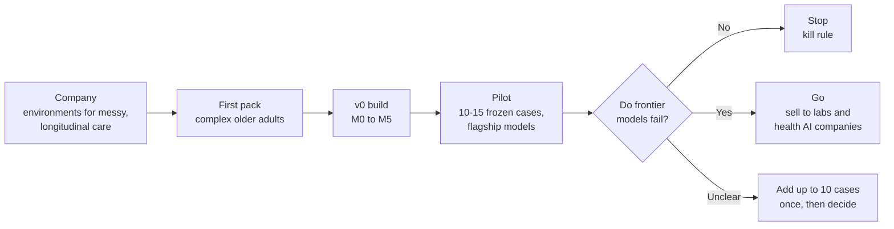
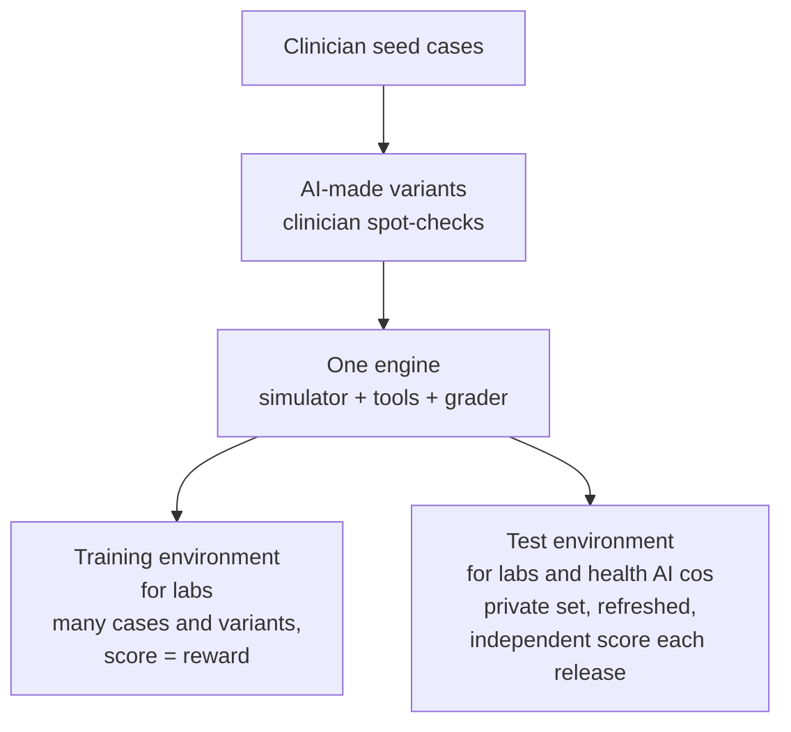
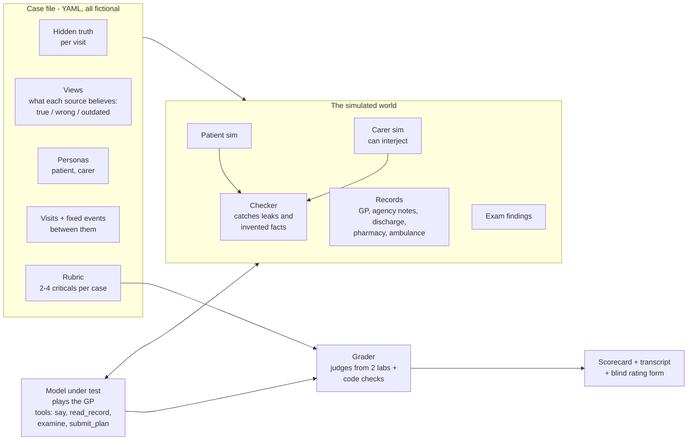
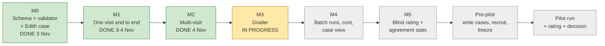
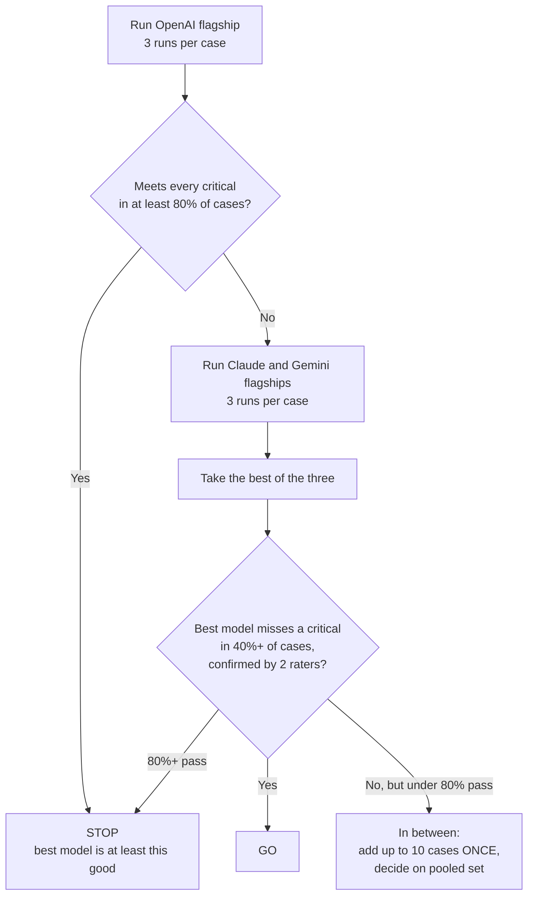

# clinical-env: the whole plan on one page

4 Nov 2026. For the clinical lead to upload to Claude chat, see the plan visually and argue with it.
Sources: `docs/brief.md`, `docs/build-v0.md`, `DECISIONS.md`, `PROGRESS.md`.
The prompt to paste is at the bottom.

---

## 1. In one breath

We are building a **simulator + harness** that tests whether AI clinicians can manage a frail
older adult over 2–3 visits when the patient, the carer and the records disagree.
**v0 asks one question: do frontier models fail at this?** If they don't, we stop.
If they do, the transcripts become the first sales sample.



---

## 2. Company scope

| Layer | What it is | Status |
| --- | --- | --- |
| Company | An **environment company**: simulator, tools and grader as one harness. No model of our own | Agreed |
| Clinical scope | Messy, longitudinal care (unreliable info, many visits, no single diagnosis) | Leaning |
| First pack | Complex older adults: function, falls, ADLs, medicines actually taken, carers, care package fit | Leaning |
| Target behaviour | Management over time, ahead of history-taking | Leaning |
| Kill rule | If frontier models already handle these cases well, stop | Agreed |
| First buyer | Proposed: lab health post-training teams via an open pack; health AI companies second | **Open** |
| Documentation AI (scribes) | Proposed: park it; revisit through discharge/care-plan summaries | **Open** |
| Pitch | Proposed: lead with the combination (function + carers + conflicting records + no single diagnosis), not "longitudinal" | Proposed |
| Raters | A second rater now; proposed later: + geriatrician + community nurse or social worker | Proposed |

**One engine, sold two ways (proposed, not agreed):**



**Moat (what's hard to copy):** clinician-written cases, real-looking records, a grader proven
against clinician raters, independence, depth in older-adult care, a growing library.
**Biggest risk:** a big lab builds its own (as OpenAI did with HealthBench).

---

## 3. The environment (what v0 actually is)



**Key rules:** the model never sees the hidden truth, the rubric or other people's views.
Each visit starts fresh; the model carries its own earlier plans as notes. People remember
what was said at visits they attended. Events between visits are fixed (they don't branch on
what the model did, in v0).

---

## 4. Milestones M0 to M5



| # | What it builds | What it proves | Status |
| --- | --- | --- | --- |
| M0 | Case schema, validator, Edith Marsh test case, model roles | Cases can be written and checked by code | Done (PR #1) |
| M1 | One visit: patient + carer sims, interjection, examine, human clinician mode | The world feels realistic to a GP (your two-transcript read) | Done (PR #2) |
| M2 | 2–3 visits in order, memory between visits, people remember | Longitudinal care works mechanically | Done (PR #3) |
| M3 | **Grader**: judge per rubric group with evidence quotes, code checks (did it read the agency notes? examine postural BP?), penalties, consultation-quality score (read first, one question at a time, ICE, proportion, UK pathways) | Scores are fair and evidence-backed | **In progress** (rubric + schema started, uncommitted) |
| M4 | Batch runner: cases × models × 3 runs, cost cap, a case view showing transcript beside sources and verdicts | One command runs the pilot; you can audit it in a browser | To do |
| M5 | Blind rating HTML form (no model names, shuffled, saves CSV) + agreement stats (kappa, AC1, ICC, grader vs raters) | Raters agree with each other and with the grader | To do |

---

## 5. Exactly what's left, step by step

Rough time guesses; clinical work sets the pace. **Case writing is the real bottleneck, not code.**

| Step | You (the clinical lead) | Agent | What it does | Rough effort |
| --- | --- | --- | --- | --- |
| 1. M3 grader | Say go on the plan; then compare the grader's verdicts on the 2 Edith transcripts with your own | Build, test, run on dev models | Gives every transcript a score with evidence | Agent 1–2 sessions; you ~30 min |
| 2. M4 batch + case view | Skim the case view once | Build | Pilot becomes one command; transcripts auditable | Agent ~1 session; you ~15 min |
| 3. M5 rating form + stats | Rate 2–3 transcripts in the form to test it | Build | Blind human ratings you can trust | Agent ~1 session; you ~30 min |
| 4. Write cases | Write **10–15 pilot cases + 2 more dev cases** (template: `docs/case-template.md`; voice notes or rough text fine) | Turn each into YAML, validate, show you a readable case view | The actual test set | **You: ~1–2 h per case = 15–30 h** |
| 5. Case QA | Play clinician on a few via human mode; fix realism | Fix simulator bugs only (never difficulty) | Cases are fair before any model sees them | You ~2–4 h |
| 6. Recruit | Ask a **GP colleague** (human baseline, 3–5 cases, not a rater) and a **second rater who isn't you** (a clinician; ideally + one more) | Draft the ask message for you | Proves criticals are achievable; independent rating | You: a few messages |
| 7. Keys + billing | Add Anthropic key to `.env`; switch on Gemini billing | Check model IDs on the day | Three labs + second-lab judge available | You ~15 min |
| 8. Freeze | Approve the freeze commit | Commit cases, rubric, prompts, thresholds; random-pick 6 twins + baseline cases; record hash in `DECISIONS.md` | No moving goalposts after results | You ~15 min |
| 9. Approve spend | Approve ~$900 total (in batches over $20) | Estimate per batch first | Money gate | You: one yes |
| 10. Pilot run | — | Run OpenAI flagship first (3 runs × each case); if not Stop, run Claude + Gemini; run twins | The experiment | Agent; hours of compute |
| 11. Rating | You + second rater rate blind (~8–10 min per transcript) | Export forms, compute agreement | Confirms misses are real | You: several hours |
| 12. Decide | Go / Stop / add up to 10 cases once | Write the result up | The answer | — |

---

## 6. Pilot decision rule (frozen before the first real run)



- **A missed case** = best model misses at least one critical in 2+ of 3 runs, confirmed by a
  clinician, where the simulator stayed on script.
- **Secondary (not go/stop):** 6 cases get a "consistent sources" twin. If the model fails the
  original but passes the twin, conflicting sources caused the failure.
- **Human baseline:** a GP colleague does 3–5 cases; their miss rate is reported beside the models'.
- **Grader usable** only if it agrees with raters at least as well as raters agree with each other.

---

## 7. Money and gates

| Item | Cost |
| --- | --- |
| Dev so far | Cheap models; well under $20 |
| Pilot: 15 cases × 3 models × 3 runs | ~$800 (if OpenAI already Stops: ~$300) |
| Twins | ~$110 |
| Judge calls | Not yet costed (M3 will give a number) |
| Gate | Any batch over $20 needs your yes first |

Rules that don't move without you: all cases fictional; criteria frozen before the first run;
the model never sees truth or rubric; stop at milestones you need to see.

---

## 8. Weak spots worth arguing about

My honest list; good places to push.

1. **15 cases is small.** 6/15 misses has a 95% interval of ~16–68%. It's a decision rule, not
   proof. Is that enough for a buyer, or only for us?
2. **"Best model" biases towards Stop.** Taking the lowest of three noisy miss rates makes Go harder.
   Intended (conservative), but know it.
3. **You write every case and set every critical.** Author bias. Only partly fixed by a non-author rater.
4. **Case writing time.** 15–30 hours on top of GP training. Is 10 cases enough to start?
5. **Simulators may be tidier than real patients**, hiding failures or creating fake ones. The
   checker and your reads reduce this; they don't remove it.
6. **Fixed events between visits.** The world doesn't react to the model's plan in v0. Realistic enough?
7. **First buyer is still open.** The pilot result may change the answer; worth deciding what
   result would make labs vs health AI companies the first call.
8. **Rater pool is thin** (you + one other, similar training). Shared blind spots.
9. **Gaming:** once public, cases leak. Test set must stay private.

---

## 9. Decisions waiting on you

- Go on the M3 grader plan (coming next from the agent).
- First buyer: labs or health AI companies (or decide after the pilot).
- Pilot size: 10 or 15 cases.
- Who is the second rater and the human-baseline GP.
- When to add the Anthropic key and Gemini billing.

---

## 10. Prompt to paste into Claude chat

Upload this file, then paste the block below.

```
I've attached the full plan for my startup project, clinical-env. I'm a UK doctor
and founder; time comes in short bursts. An AI agent builds the code; I own
clinical judgement and product decisions.

What I want from you:

1. VISUALS FIRST. Make one clean interactive artifact (or diagrams) that shows:
   - the big picture: company -> first pack -> v0 build -> pilot -> go/stop
   - the environment: case file, simulated patient/carer/records, model under test, grader
   - the milestone timeline M0-M5 and pre-pilot steps, with done / in progress / to do
   - the pilot decision tree
   - a "who does what" view: my jobs vs the agent's jobs, with rough hours
   Plain English, short labels, no jargon walls. Render the mermaid diagrams in the file if
   that is easiest.

2. THEN CHALLENGE THE PLAN with me. Act as a sharp, sceptical co-founder who knows RL
   environments, clinical AI evaluation and early-stage startups. Start from section 8
   ("Weak spots") and add any I've missed. For each point:
   - say the problem in one or two sentences,
   - give your recommended change and one alternative,
   - ask me ONE question, then wait for my answer.
   Go one point at a time. Keep every reply short.

3. Things NOT to change without a strong reason (they were agreed deliberately): all cases
   fictional; failure criteria frozen before the first run; the model under test never sees
   the hidden truth or rubric; older adults only for the pilot; OpenAI flagship runs first;
   judges from a different lab to the model being scored.

4. At the end, give me a short list titled "Agreed changes" (what, why, one line each) that I
   can paste back to my coding agent so it can update DECISIONS.md and the spec.

Ask me clarifying questions before step 1 only if something in the file is genuinely unclear.
```
